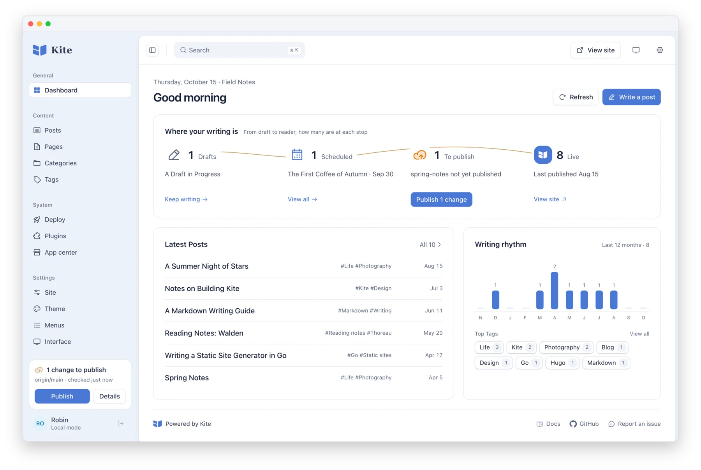
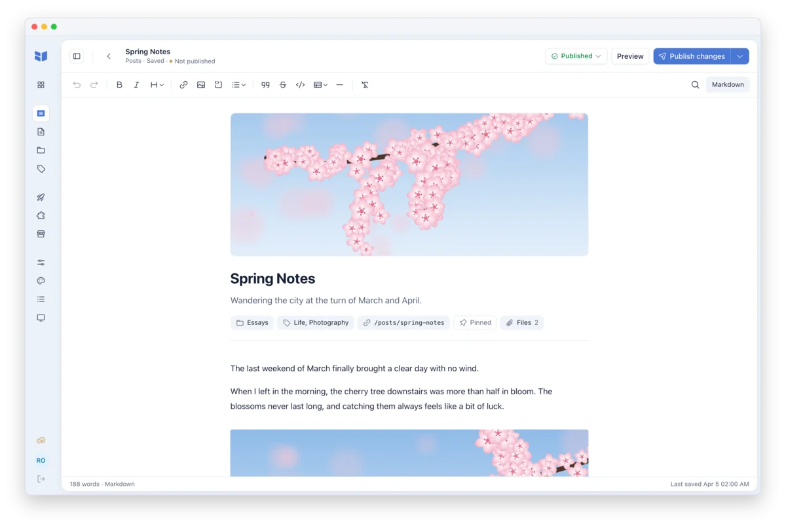
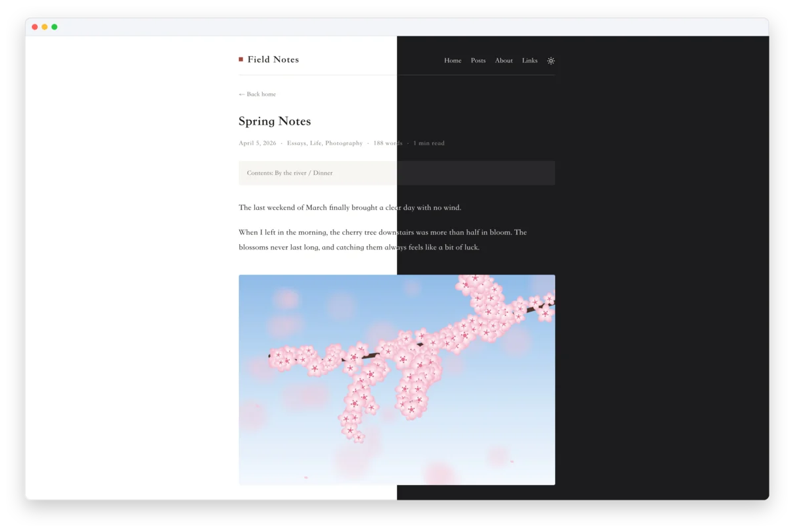
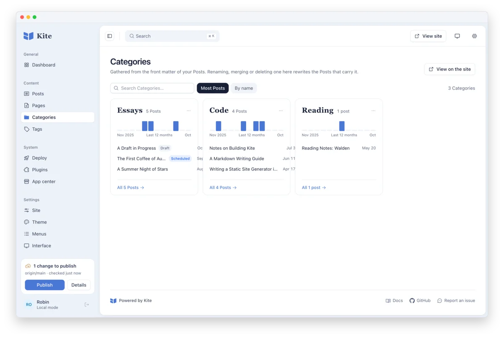
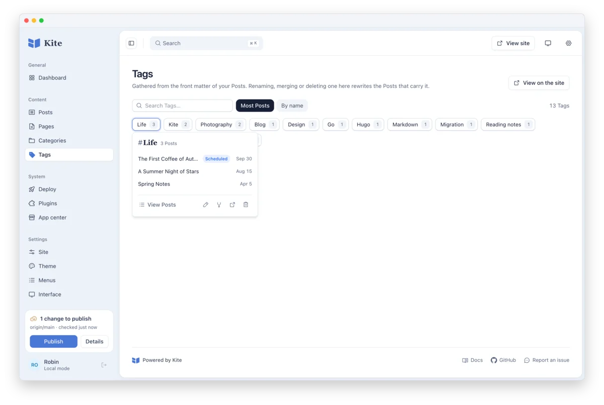
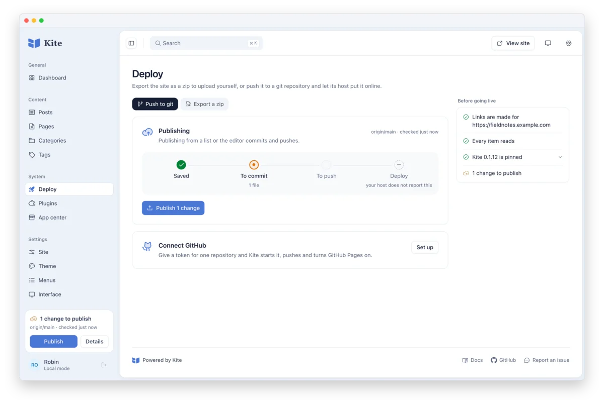
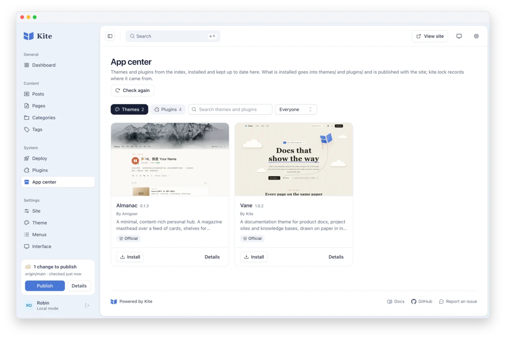

<p align="center">
  
</p>

<h1 align="center">Kite</h1>

<p align="center">
  <b>Write in Markdown. Manage it in your browser. Publish on your terms.</b>
</p>

<p align="center">
  A blog engine in a single Go binary, with its writing studio built in:<br>
  the comfort of a CMS, and files that stay plain Markdown you own.
</p>

<p align="center">
  <a href="https://github.com/kite-plus/kite/releases/latest"></a>
  <a href="https://github.com/kite-plus/kite/actions/workflows/ci.yml"></a>
  <a href="go.mod"></a>
  <a href="https://github.com/kite-plus/kite/pkgs/container/kite"></a>
  <a href="https://github.com/kite-plus/kite/releases"></a>
  <a href="LICENSE"></a>
</p>

<p align="center">
  <a href="https://www.kite.plus"><b>Website</b></a> ·
  <a href="docs/reference.md"><b>Documentation</b></a> ·
  <a href="https://github.com/kite-plus/kite/releases/latest"><b>Download</b></a> ·
  English · <a href="README.zh-CN.md">简体中文</a>
</p>

<p align="center">
  <picture>
    <source media="(prefers-color-scheme: dark)" srcset="docs/assets/screenshots/en/dashboard-dark.webp">
    
  </picture>
</p>

## Why Kite

<table>
  <tr>
    <td width="50%" valign="top">
      <h3>A studio in your browser</h3>
      <p>A visual editor that reads and writes Markdown, with the source one click away. Drag in pictures, set categories and tags, keep drafts, schedule posts.</p>
    </td>
    <td width="50%" valign="top">
      <h3>Files that stay yours</h3>
      <p>Every post is a Markdown file on disk. Saving rewrites only what changed and keeps your key order and comments, so editing a title is a one-line <code>git diff</code>.</p>
    </td>
  </tr>
  <tr>
    <td valign="top">
      <h3>Publish your way</h3>
      <p>Export static pages for any host, connect GitHub and let Pages deploy every push, or run the site on your own server, in Docker or not.</p>
    </td>
    <td valign="top">
      <h3>One binary, nothing else</h3>
      <p>The studio, a default theme in light and dark, and the SQLite driver are compiled in. There is no Node, database server or runtime to install.</p>
    </td>
  </tr>
  <tr>
    <td valign="top">
      <h3>Themes and plugins by name</h3>
      <p>Comments, analytics, search and math come as official plugins, beside documentation and personal themes. The app center installs them and keeps them up to date; a plugin adds code to pages, or runs WebAssembly in a sandbox while the site builds.</p>
    </td>
    <td valign="top">
      <h3>Builds you can repeat</h3>
      <p><code>kite.lock</code> pins the Kite release a site builds with and <code>kitew</code> runs it, so the deploy uses the Kite you previewed with. Kite tells you when a newer one is out.</p>
    </td>
  </tr>
</table>

## Quick start

Download the archive for your system from the [latest release](https://github.com/kite-plus/kite/releases/latest), unpack it, and put `kite` on your `PATH`. Then start a site in an empty folder:

```bash
mkdir blog && cd blog
kite run
```

The browser opens on a page that asks what the site is called and who writes it; answer it and you are in the [studio](http://localhost:1717/admin/). Next time, run `kite run` from the same folder. `kite init` asks the same questions in a terminal instead.

<details>
<summary><b>On macOS</b></summary>

A downloaded program is held back the first time it runs; `xattr -d com.apple.quarantine kite` lets it through. Every archive can be checked against the `checksums.txt` in its release.

</details>

<details>
<summary><b>With Docker</b>, on a server</summary>

```bash
docker run -d --name kite --restart unless-stopped \
  -p 127.0.0.1:1717:1717 -v kite-data:/data ghcr.io/kite-plus/kite:latest
```

Open the [studio](http://localhost:1717/admin/) and follow the setup steps to name the site and create its account; the site itself is at [localhost:1717](http://localhost:1717). Content and the account live in the `kite-data` volume. Put it behind HTTPS before it is reachable from other machines; the [deployment guide](docs/reference.md#deploying) shows how.

</details>

<details>
<summary><b>From source</b></summary>

Requires Git, Make, Go 1.26.4+, Node.js 22.19.0 and pnpm 10.11.1; the build uses the Go toolchain the project pins.

```bash
git clone https://github.com/kite-plus/kite.git
cd kite
make web
make install
```

Add Go's binary directory (usually `~/go/bin`) to your `PATH`. To build the container image yourself, run `docker build -t kite .` in the clone.

</details>

Coming from another generator? A Hugo site's content opens where it is, and `kite import hexo ../old-blog blog` brings a Hexo site into a new one, old addresses included. See [Moving from Hugo](docs/reference.md#moving-from-hugo) and [Moving from Hexo](docs/reference.md#moving-from-hexo).

## A look around

<table>
  <tr>
    <td width="50%" valign="top">
      
      <p><b>The editor.</b> Cover, summary and properties sit above the text. One button publishes; saving alone is in its menu and on <kbd>⌘S</kbd>.</p>
    </td>
    <td width="50%" valign="top">
      
      <p><b>The site.</b> The default theme in light and dark, with a table of contents, reading time and nothing to configure.</p>
    </td>
  </tr>
  <tr>
    <td valign="top">
      
      <p><b>Categories.</b> Each one a card with a year of writing and its newest posts. Rename, merge or remove one, and every post that carries it is rewritten.</p>
    </td>
    <td valign="top">
      
      <p><b>Tags.</b> A wall of chips with their counts; open one to see its posts and change it.</p>
    </td>
  </tr>
  <tr>
    <td valign="top">
      
      <p><b>Deploy.</b> Push to Git or export a zip, follow a change from saved to deployed, and check the address, content and Kite release before going live.</p>
    </td>
    <td valign="top">
      
      <p><b>App center.</b> Themes and plugins from a signed index, installed by name and kept up to date, with <code>kite.lock</code> recording where each came from.</p>
    </td>
  </tr>
</table>

## How it works

<p align="center">
  
</p>

Your Markdown files are the source of truth. The studio edits them in place, and the index Kite keeps under `.kite/` is only a cache: delete it, rebuild, and the same data comes back. The same files become static pages with `kite build`, a live site with `kite run`, or a Git commit with `kite publish`.

- **Export static pages.** Deploy in the studio exports the site as a zip to upload anywhere; `kite build` writes the same files to `public/`.
- **Deploy through Git.** Connect GitHub from the studio with a token for one empty repository, and Kite pushes the site to it, writes the workflow and turns Pages on. Every publish after that commits and pushes, and the site deploys itself.
- **Run it on a server.** Serve the site and the studio from your own machine; the [deployment guide](docs/reference.md#deploying) covers domains, HTTPS and Docker.

## Themes and plugins

| | Name | What it does |
|---|---|---|
| Theme | [Vane](https://github.com/kite-plus/theme-vane) | Documentation sites: a home page, docs in an ordered tree, news and search |
| Theme | [Almanac](https://github.com/kite-plus/theme-almanac) | A personal hub: a magazine masthead over a feed of cards, with shelves for projects, books and more |
| Plugin | [Comments](https://github.com/kite-plus/plugin-comments) | A comment thread under every post, with Giscus, Waline or Twikoo |
| Plugin | [Search](https://github.com/kite-plus/plugin-search) | Search in the reader's browser, with nothing to run |
| Plugin | [Math](https://github.com/kite-plus/plugin-math) | TeX math and Mermaid diagrams in plain Markdown |
| Plugin | [Analytics](https://github.com/kite-plus/plugin-analytics) | Visits counted with Umami, Plausible, Google Analytics or Baidu Tongji |

Install any of them from the studio's app center, or by name in a terminal: `kite theme add vane`, `kite plugin add search`. More are listed in [awesome](https://github.com/kite-plus/awesome), and [a theme of your own](docs/reference.md#themes) is Go templates written against a frozen contract, `kite/v1`.

## Roadmap

- **Done:** static builds, live serving, the browser studio and Git publishing (M0–M4); WebAssembly plugins (M8); the frozen theme contract `kite/v1` (M5); the app center with a signed index; pinned releases through `kite.lock` and `kitew` (part of M6); connecting GitHub; and, since 0.1.12, a notice when a newer Kite is out.
- **Next:** builds that skip what has not changed (the rest of M6), and a dynamic mode backed by SQLite (M7).

The [reference guide](docs/reference.md#roadmap) lists every milestone, and the [roadmap](docs/design/roadmap.md) tracks progress item by item. Kite is young: things may still change between 0.1 releases, and the release notes say how to move across each one.

## Contributing

- **Report a bug or share an idea:** [open an issue](https://github.com/kite-plus/kite/issues) with your version, system and steps to reproduce.
- **Send a change:** read the [contributing notes](docs/reference.md#contributing) and run `make check` before you open a pull request. If a change conflicts with the [design documents](docs/design/), update the documents first.

## License

Kite is released under the [Apache License 2.0](LICENSE).
