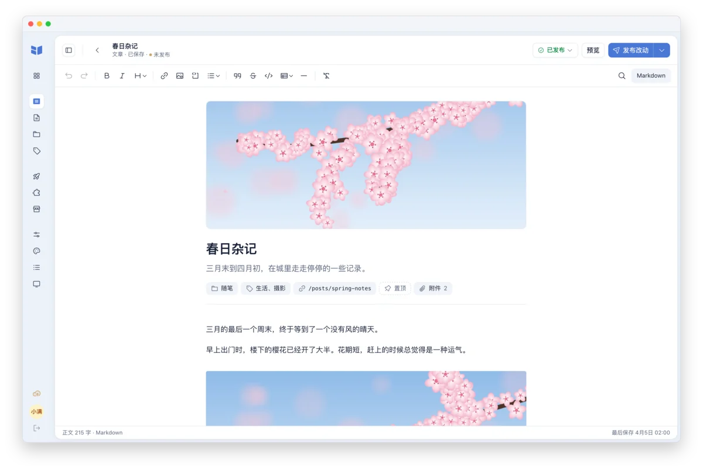
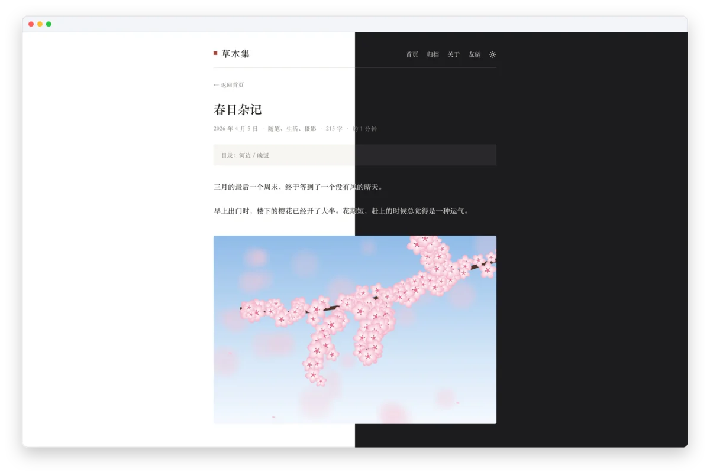
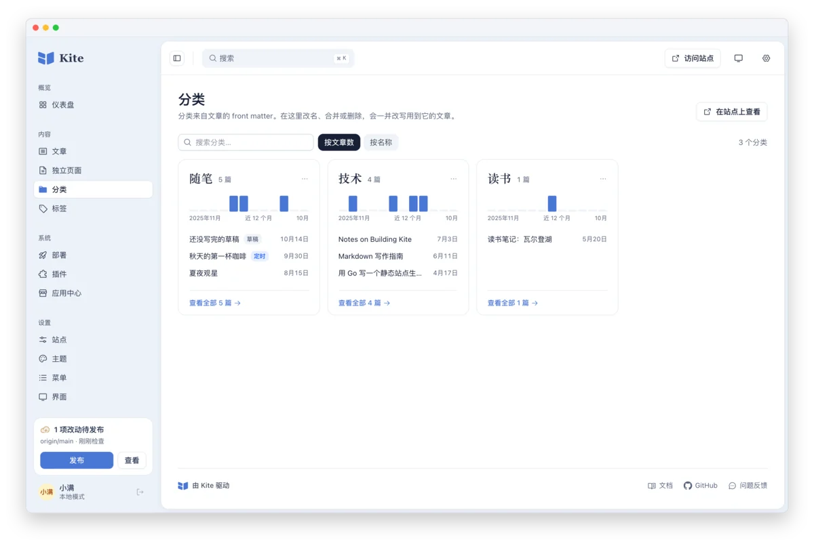
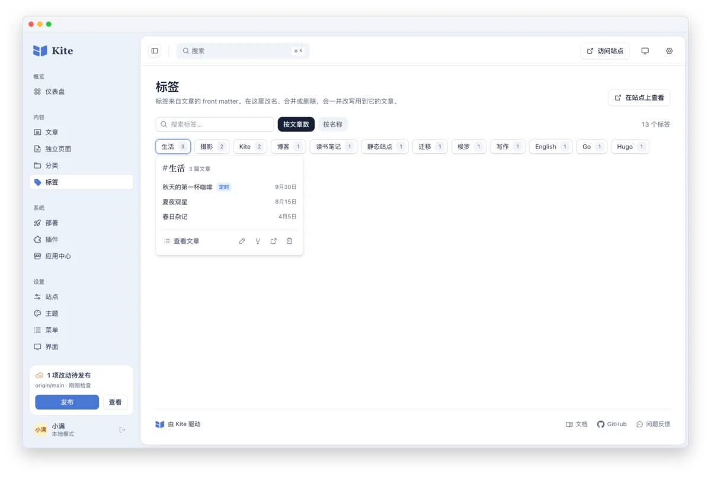
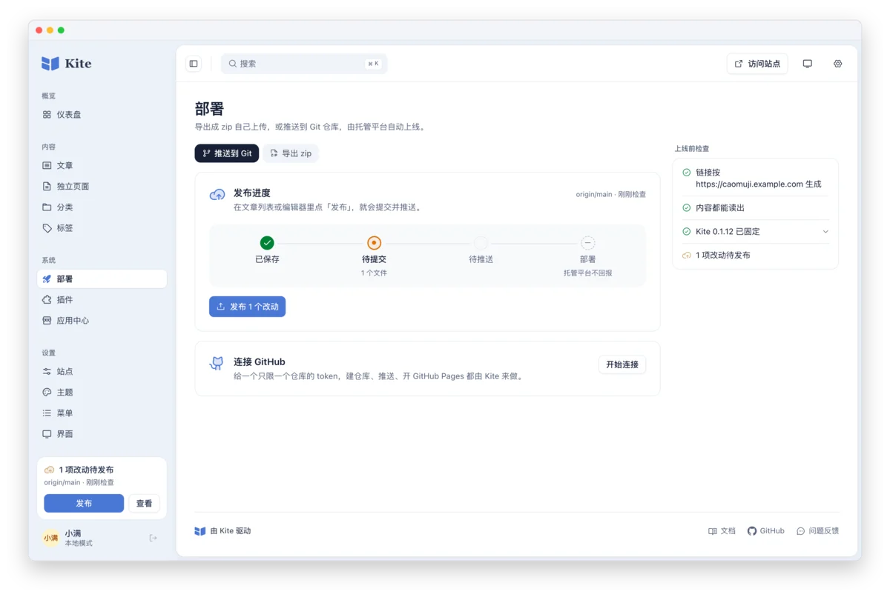

<p align="center">
  
</p>

<h1 align="center">Kite</h1>

<p align="center">
  <b>用 Markdown 写作，在浏览器里管理，发布到你想去的地方。</b>
</p>

<p align="center">
  一个 Go 程序就是一整套博客，写作后台内置其中：<br>
  有 CMS 的顺手，文件始终是属于你自己的 Markdown。
</p>

<p align="center">
  <a href="https://github.com/kite-plus/kite/releases/latest"></a>
  <a href="https://github.com/kite-plus/kite/actions/workflows/ci.yml"></a>
  <a href="go.mod"></a>
  <a href="https://github.com/kite-plus/kite/pkgs/container/kite"></a>
  <a href="https://github.com/kite-plus/kite/releases"></a>
  <a href="LICENSE"></a>
</p>

<p align="center">
  <a href="https://www.kite.plus"><b>官网</b></a> ·
  <a href="docs/reference.zh-CN.md"><b>文档</b></a> ·
  <a href="https://github.com/kite-plus/kite/releases/latest"><b>下载</b></a> ·
  <a href="README.md">English</a> · 简体中文
</p>

<p align="center">
  <picture>
    <source media="(prefers-color-scheme: dark)" srcset="docs/assets/screenshots/zh-CN/dashboard-dark.webp">
    
  </picture>
</p>

## 为什么用 Kite

<table>
  <tr>
    <td width="50%" valign="top">
      <h3>浏览器里的后台</h3>
      <p>可视化编辑器直接读写 Markdown，一键切换源码。拖入图片，设置分类和标签，保留草稿，定时发布。</p>
    </td>
    <td width="50%" valign="top">
      <h3>文件始终属于你</h3>
      <p>每篇文章都是磁盘上的一个 Markdown 文件。保存时只改写真正变化的部分，key 的顺序和注释原样保留，改个标题，<code>git diff</code> 只有一行。</p>
    </td>
  </tr>
  <tr>
    <td valign="top">
      <h3>发布方式由你选</h3>
      <p>导出静态页面放到任意托管平台，连接 GitHub 让 Pages 自动部署每次推送，或者在自己的服务器上运行站点，用不用 Docker 都行。</p>
    </td>
    <td valign="top">
      <h3>一个程序，别无他物</h3>
      <p>后台、支持深浅色的默认主题和 SQLite 驱动都已编译进这一个程序，不用再装 Node、数据库服务或别的运行环境。</p>
    </td>
  </tr>
  <tr>
    <td valign="top">
      <h3>按名字装主题和插件</h3>
      <p>评论、统计、站内搜索、公式与图表都有官方插件，另有文档站和个人站主题。应用中心负责安装和更新；插件可以往页面里加代码，也可以在构建时于沙箱中运行 WebAssembly。</p>
    </td>
    <td valign="top">
      <h3>构建可以复现</h3>
      <p><code>kite.lock</code> 固定站点构建用的 Kite 版本，由 <code>kitew</code> 运行，部署时用的就是你预览时的那个 Kite。有新版本时，Kite 会提醒你。</p>
    </td>
  </tr>
</table>

## 快速开始

从[最新版本](https://github.com/kite-plus/kite/releases/latest)下载对应系统的压缩包，解压后把 `kite` 放进 `PATH`。然后在一个空文件夹里启动：

```bash
mkdir blog && cd blog
kite run
```

浏览器会打开建站页面，填上站点名称和你的名字，就进入了[写作后台](http://localhost:1717/admin/)。之后在同一个文件夹里运行 `kite run` 即可。想在终端里回答这些问题，可以改用 `kite init`。

<details>
<summary><b>在 macOS 上</b></summary>

下载的程序第一次运行会被系统拦下，运行 `xattr -d com.apple.quarantine kite` 即可放行。每个压缩包都可以用版本附带的 `checksums.txt` 校验。

</details>

<details>
<summary><b>用 Docker</b> 在服务器上运行</summary>

```bash
docker run -d --name kite --restart unless-stopped \
  -p 127.0.0.1:1717:1717 -v kite-data:/data ghcr.io/kite-plus/kite:latest
```

打开[写作后台](http://localhost:1717/admin/)，按提示设置站点和账号；站点本身在 [localhost:1717](http://localhost:1717)。内容和账号保存在 `kite-data` 数据卷里。让别的机器访问之前，先放到 HTTPS 后面，做法见[部署说明](docs/reference.zh-CN.md#部署)。

</details>

<details>
<summary><b>从源码构建</b></summary>

需要 Git、Make、Go 1.26.4+、Node.js 22.19.0 和 pnpm 10.11.1，构建会使用项目指定的 Go 工具链。

```bash
git clone https://github.com/kite-plus/kite.git
cd kite
make web
make install
```

把 Go 的二进制目录（通常是 `~/go/bin`）加入 `PATH`。想自己构建容器镜像，在克隆的目录里运行 `docker build -t kite .`。

</details>

从其他博客程序迁移过来？Hugo 站点的内容原地就能打开；`kite import hexo ../old-blog blog` 会把 Hexo 站点连同旧地址一起导入一个新站点。详见[从 Hugo 迁移](docs/reference.zh-CN.md#从-hugo-迁移)和[从 Hexo 迁移](docs/reference.zh-CN.md#从-hexo-迁移)。

## 看一看

<table>
  <tr>
    <td width="50%" valign="top">
      
      <p><b>编辑器。</b>封面、摘要和属性都在正文上方。一个按钮负责发布；只保存放在它的菜单里，也可以按 <kbd>⌘S</kbd>。</p>
    </td>
    <td width="50%" valign="top">
      
      <p><b>站点。</b>默认主题自带浅色和深色，有目录和阅读时间，不用任何配置。</p>
    </td>
  </tr>
  <tr>
    <td valign="top">
      
      <p><b>分类。</b>每个分类一张卡片，带一年的写作节奏和最新的文章。改名、合并或删除，用到它的文章都会一并改写。</p>
    </td>
    <td valign="top">
      
      <p><b>标签。</b>平铺成一面墙，带着篇数；点开一个，就能看到它的文章并修改它。</p>
    </td>
  </tr>
  <tr>
    <td valign="top">
      
      <p><b>部署。</b>推送到 Git 或导出 zip，看着改动从保存走到部署，上线前检查站点地址、内容和 Kite 版本。</p>
    </td>
    <td valign="top">
      
      <p><b>应用中心。</b>从签过名的索引按名字安装、更新主题和插件，<code>kite.lock</code> 记下每一个的来源。</p>
    </td>
  </tr>
</table>

## 工作方式

<p align="center">
  
</p>

Markdown 文件是唯一的真相源。后台直接编辑这些文件，Kite 在 `.kite/` 下维护的索引只是缓存：删掉、重建，得到的数据完全一样。同一份文件，用 `kite build` 生成静态页面，用 `kite run` 运行站点，用 `kite publish` 提交到 Git。

- **导出静态页面**：在后台「部署」里把网站导出成 zip，上传到任何地方；命令行里 `kite build` 会把同样的文件写到 `public/`。
- **通过 Git 部署**：在后台用一个只限一个空仓库的 token 连接 GitHub，Kite 会把站点推送上去、写好工作流并开启 Pages。之后每次发布都会提交并推送，站点自动上线。
- **在服务器上运行**：在自己的机器上提供站点和后台；域名、HTTPS 和 Docker 见[部署说明](docs/reference.zh-CN.md#部署)。

## 主题和插件

| | 名字 | 做什么 |
|---|---|---|
| 主题 | [风标 Vane](https://github.com/kite-plus/theme-vane) | 文档站：首页、按顺序排列的文档树、新闻和搜索 |
| 主题 | [年鉴 Almanac](https://github.com/kite-plus/theme-almanac) | 个人站：杂志式刊头下面是一列卡片，另有项目、书影等书架 |
| 插件 | [评论 Comments](https://github.com/kite-plus/plugin-comments) | 每篇文章下面的评论区，支持 Giscus、Waline 和 Twikoo |
| 插件 | [搜索 Search](https://github.com/kite-plus/plugin-search) | 在读者的浏览器里搜索，不用运行任何服务 |
| 插件 | [公式 Math](https://github.com/kite-plus/plugin-math) | 用普通的 Markdown 写 TeX 公式和 Mermaid 图表 |
| 插件 | [统计 Analytics](https://github.com/kite-plus/plugin-analytics) | 用 Umami、Plausible、Google Analytics 或百度统计记录访问 |

在后台的应用中心里安装，或者在终端里按名字安装：`kite theme add vane`、`kite plugin add search`。更多主题和插件见 [awesome](https://github.com/kite-plus/awesome)；[自己写主题](docs/reference.zh-CN.md#主题)就是按冻结的契约 `kite/v1` 写 Go 模板。

## 路线图

- **已完成**：静态构建、实时预览服务、浏览器后台和 Git 发布（M0–M4）；WebAssembly 插件（M8）；冻结的主题契约 `kite/v1`（M5）；带签名索引的应用中心；用 `kite.lock` 和 `kitew` 固定构建版本（M6 的一部分）；连接 GitHub；以及 0.1.12 起的新版本提醒。
- **接下来**：跳过没有变化的部分的增量构建（M6 剩下的部分），以及基于 SQLite 的动态模式（M7）。

完整的里程碑列表见[详细使用说明](docs/reference.zh-CN.md#路线图)，逐项进度见[路线图与实现现状](docs/design/roadmap.md)。Kite 还年轻：0.1 的各个版本之间仍可能有变化，每次的发布说明都会写明如何升级。

## 参与贡献

- **反馈问题或提出想法**：[提交 Issue](https://github.com/kite-plus/kite/issues)，写明版本、系统和复现步骤。
- **提交改动**：先阅读[参与贡献说明](docs/reference.zh-CN.md#参与贡献)，提交 PR 前运行 `make check`。与[设计文档](docs/design/)冲突的改动，先改文档，再改代码。

## 许可证

Kite 以 [Apache License 2.0](LICENSE) 发布。
